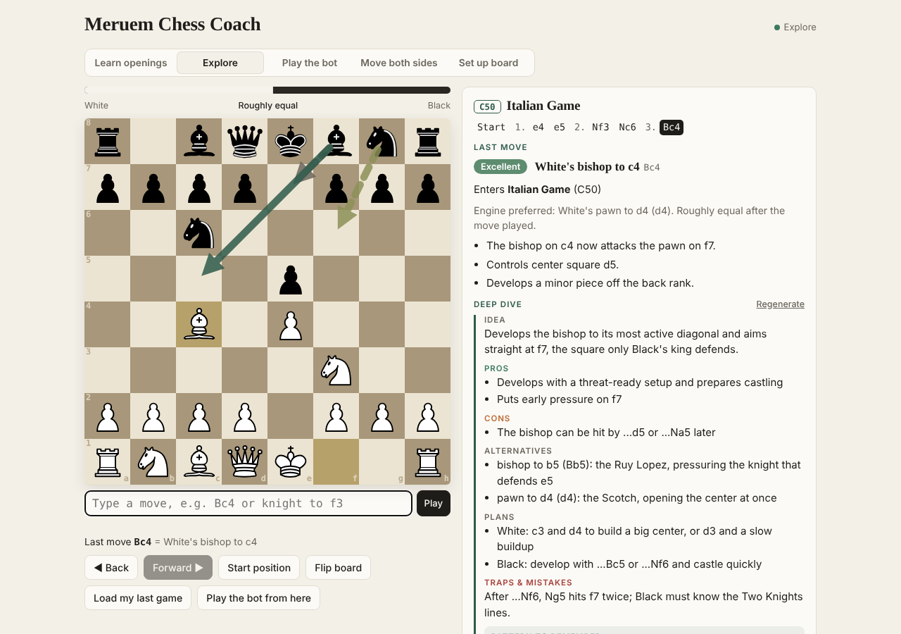
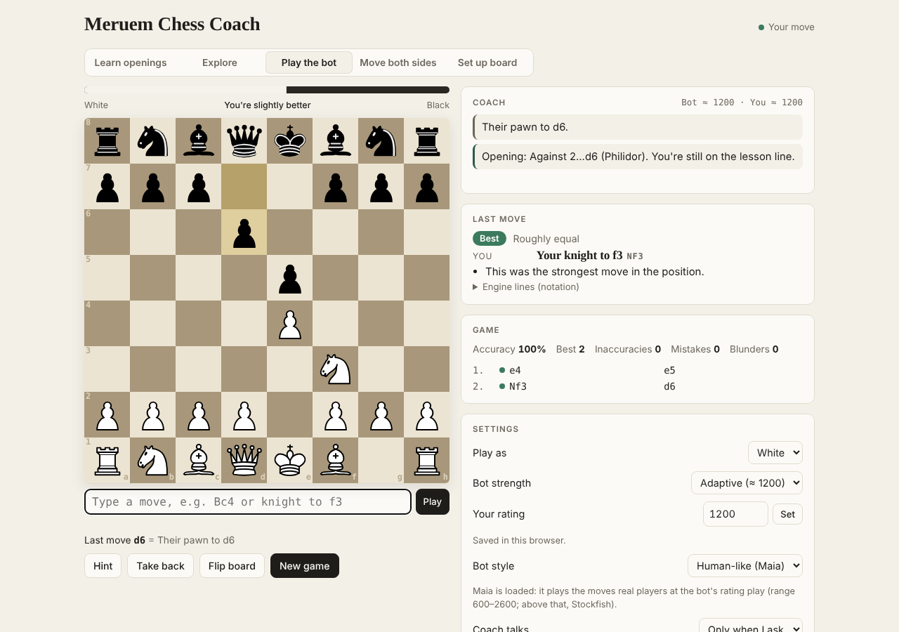

# Meruem Chess Coach

I started learning chess and wanted something that explains every move as I play it, instead of showing an engine number and leaving me to work out why. This is that tool. It runs entirely in the browser: Stockfish for analysis, Maia (a neural net trained on real human games) for an opponent that plays like an actual person at my level, and optionally Claude to explain positions in plain English.

The name comes from Meruem in Hunter x Hunter, who learns a board game from scratch and is beating the world champion within days. That was roughly the goal.

**Live:** https://zvezda4994.github.io/meruem-chess-coach/



## What it does

There are five modes.

**Learn openings.** 64 short lessons covering the Italian Game, a full repertoire for White and Black, common traps and basic middlegame plans. Each lesson has a study mode where you step through the moves with notes, and a drill mode where you have to play the moves yourself.

**Explore.** Play moves for both sides and get a breakdown of every position:

- the opening name and ECO code (all 3,865 positions in the Lichess opening database, so transpositions are recognised)
- a move table with Stockfish's top five moves and evaluations, every named continuation from the current position, and what percentage of players around my rating actually pick each move (from Maia)
- facts calculated from the board: what the last move attacks, defends or opens up, pins, forks, loose pieces, pawn weaknesses, open files, king safety, space and mobility
- with an API key, a written breakdown of the move (the idea behind it, pros and cons, alternatives, plans for both sides, traps to know) plus a box for follow-up questions

**Play the bot.** You play against Maia at a rating that adjusts after every game. Every move you make is graded from Best down to Blunder and compared to the engine's choice. A coach panel warns you about threats, points out when you can win material, and tells you when you've left one of the opening lines from the Learn tab. After the game you get an accuracy score, an evaluation graph you can click through, the three biggest turning points, and a running tally of the mistakes you make most often.

**Move both sides.** Free analysis with the same grading.

**Set up board.** Place pieces or paste a FEN and analyse or play from there.

Moves can be typed as well as clicked. The input takes normal notation (`Nf3`), lowercase (`nf3`), squares (`e2e4`, `e2 e4`), words (`knight to f3`, `bishop takes c3`, `castle long`) or a whole line (`1. e4 e5 2. Nf3 Nc6`). If something is ambiguous, like `bc3` when both the bishop and the b-pawn can go there, it asks instead of guessing.



## How it works

It's a static site with no build step and no backend. Everything heavy runs in Web Workers.

- **Stockfish 17.1** (the lite WASM build) is driven over UCI. Analysis uses MultiPV so move grades, the explorer table and the "what was better" suggestions all come from the same search. Moves are graded by how much they drop the side's win probability, using the same centipawn to win% curve Lichess uses.
- **Maia-3** runs through ONNX Runtime Web. The board gets encoded as 64 squares × 12 piece types (flipped when Black is to move), the model returns scores for 4,352 possible moves, and illegal ones are masked out before the softmax. The bot samples from that distribution at its current rating, which is why its mistakes look like the ones real players make. The model is 45 MB, so it's split into four files and joined in the worker, and only downloaded once you need it.
- **Threat detection** works by passing the turn: the engine searches the position as if the opponent could move twice, and if that wins material or mates, the coach warns you.
- **Claude** (optional) is called directly from the browser with your own Anthropic API key. The prompts include the engine lines and the board facts the app calculated, and the model has a `check_move` tool that runs Stockfish on any move it wants to talk about. That keeps the explanations tied to what the engine actually sees. Write-ups are cached per position.
- **Opening names** come from a lookup table keyed by position (piece placement, side to move, castling, en passant), built from the Lichess dataset by `scripts/build-openings.js`.

```
index.html
css/styles.css
js/app.js               board, engine, game flow, coach, explorer, review, lessons
js/notation.js          typed-move parser
js/claude-runtime.js    Anthropic API client (streaming + tool calls)
data/                   lessons and opening names
maia/                   Maia model, worker and ONNX Runtime
vendor/                 chess.js and Stockfish
tests/                  parser tests
```

## Running it

The engines run in Web Workers, so the page needs to be served over HTTP rather than opened as a file.

```bash
npm start      # http://localhost:8080
npm test       # parser tests, Node 18+
```

`python3 -m http.server` works too.

To turn on the explanations and the question box, paste an Anthropic API key into the card at the bottom of the page. It's saved in your browser's localStorage and only ever sent to `api.anthropic.com`. Everything else works without one.

## Deploying

The workflow in `.github/workflows/pages.yml` runs the tests and publishes to GitHub Pages on every push to `main`. In the repo settings, set Pages to deploy from GitHub Actions. Any static host works too, since there's nothing to build.

## Credits

- [Stockfish](https://stockfishchess.org/), using the [stockfish](https://www.npmjs.com/package/stockfish) npm build by Nathan Rugg (GPL-3.0)
- [Maia](https://www.maiachess.com/) by the University of Toronto Computational Social Science Lab, model and board encoding from [maia-platform-frontend](https://github.com/CSSLab/maia-platform-frontend) (GPL-3.0)
- [ONNX Runtime Web](https://github.com/microsoft/onnxruntime) (MIT)
- [chess.js](https://github.com/jhlywa/chess.js) (BSD-2-Clause)
- Opening names from [lichess-org/chess-openings](https://github.com/lichess-org/chess-openings) (CC0)
- cburnett piece set by Colin M.L. Burnett, via [Lichess](https://github.com/lichess-org/lila) (GPLv2+)

Licensed under GPL-3.0 because Stockfish and Maia are.
